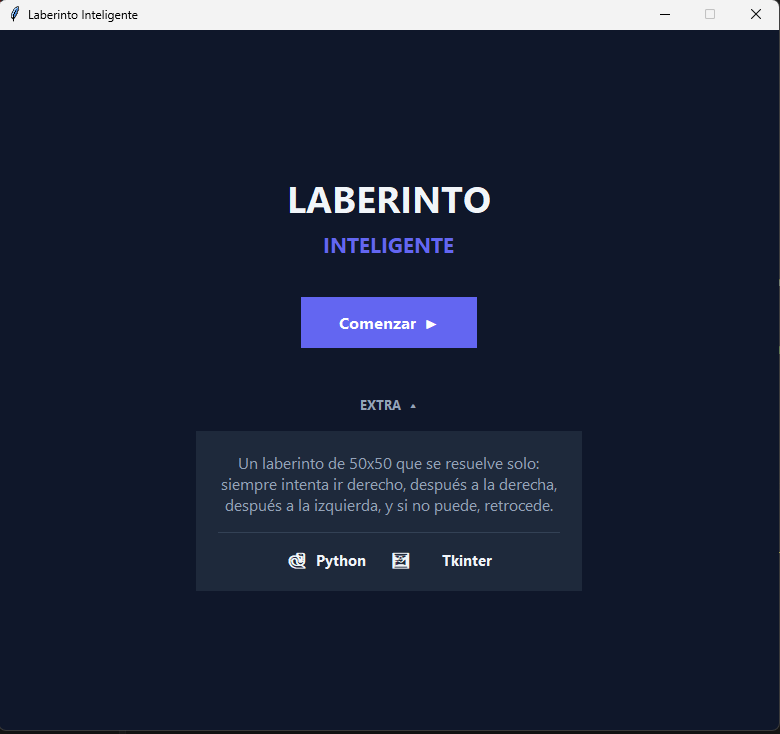
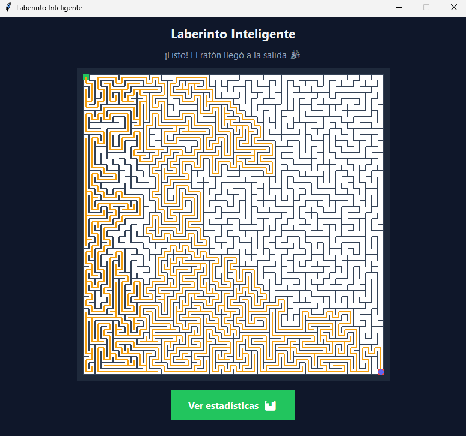

# Laberinto Python

Aplicación en Python que genera laberintos bidimensionales de forma procedural y los resuelve automáticamente en vivo mediante una interfaz gráfica hecha con **Tkinter**.

El proyecto separa la lógica algorítmica y el manejo de matrices (`laberinto.py`) de la capa de visualización y animación (`interfaz.py`).

## Capturas




## Algoritmos implementados (en `laberinto.py`)

El laberinto se modela con 4 matrices booleanas de `filas x columnas` (`pared_norte`, `pared_sur`, `pared_este`, `pared_oeste`), donde `True` indica pared cerrada y `False` indica paso libre.

1. **Generación del laberinto (`generar_laberinto`):**
   - Utiliza **Búsqueda en Profundidad (DFS) aleatoria iterativa con *backtracking***.
   - Comienza en la celda `(0, 0)` con todas las paredes cerradas y emplea listas como pilas explícitas (`pila_filas`, `pila_columnas`) junto con una matriz de celdas visitadas.
   - En cada paso elige al azar (`random.randint`) un vecino no visitado, derriba la pared compartida entre ambas celdas y avanza. Si llega a un callejón sin salida (sin vecinos libres por visitar), desapila (`pop()`) para retroceder hasta encontrar un nuevo camino.
2. **Resolución automática (`resolver_laberinto`):**
   - Utiliza un recorrido en profundidad con ***backtracking* mediante pilas explícitas** que almacenan la fila, columna y dirección actual del agente ("ratón").
   - En cada celda evalúa las direcciones relativas a su orientación actual siguiendo este orden de prioridad:
     1. **Seguir derecho** (mantener la dirección actual).
     2. **Girar a la derecha** (`direccion_a_la_derecha`).
     3. **Girar a la izquierda** (`direccion_a_la_izquierda`).
   - Si ninguna de las tres direcciones conduce a una celda accesible y no visitada, realiza *backtracking* (`pop()`) a la celda anterior.
   - Retorna tanto el `camino_completo` (todos los pasos dados, incluidos los retrocesos, para animarlos en pantalla) como el `camino_final` limpio desde la entrada `(0, 0)` hasta la salida `(filas - 1, columnas - 1)`.

## Tecnologías utilizadas

- **Python 3** (librería estándar, sin dependencias externas).
- **`tkinter`:** Interfaz gráfica y renderizado en `Canvas` de un laberinto de 50×50 celdas con animación paso a paso mediante `after()`.
- **`random`:** Selección aleatoria de vecinos durante la generación del laberinto y soporte opcional de semilla (`semilla_aleatoria`).

## Estructura del proyecto

```text
Laberinto_Python/
├── laberinto.py      # Lógica de matrices, generación DFS y resolución con backtracking
├── interfaz.py       # Ventana en Tkinter, dibujo en Canvas y animación del recorrido
├── img/              # Capturas de pantalla del funcionamiento
└── README.md
```

## Cómo ejecutarlo

No requiere instalar paquetes adicionales. Desde la carpeta del proyecto:

```bash
git clone https://github.com/Uri46/Laberinto_Python.git
cd Laberinto_Python
python interfaz.py
```

También se puede importar el módulo lógico de forma independiente:

```python
import laberinto

pn, ps, pe, po = laberinto.generar_laberinto(10, 10)
recorrido, solucion = laberinto.resolver_laberinto(10, 10, pn, ps, pe, po, 0, 0, 9, 9)
print(f"Pasos totales (con retrocesos): {len(recorrido)} | Camino final: {len(solucion)}")
```
